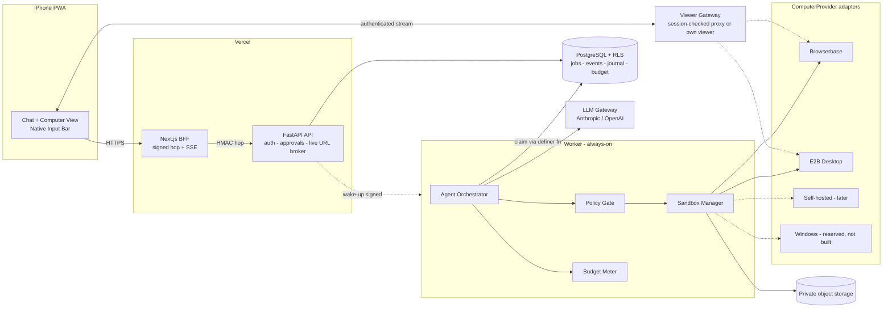

# SAFWAN SMART — خطة الكمبيوتر السحابي الرئيسية

| | |
|---|---|
| **الحالة** | مسودة معتمدة للتنفيذ بعد مرحلة التحقق (Phase 0). وثائق فقط — لا تغيير في كود التطبيق |
| **الإصدار** | 1.0 (مراجعة على التقرير الأول بتاريخ 2026-10-31) |
| **أساس الفحص** | `main @ 9f482a9` + PR #26 (`feat/b0-b1-foundation @ 856ea67`، غير مدموج) |
| **الوثائق المرافقة** | [`ADR-LOG.md`](ADR-LOG.md) · [`PHASE-0-EXECUTION-PLAN.md`](PHASE-0-EXECUTION-PLAN.md) |

> **قاعدة قراءة هذه الوثيقة:** كل رقم أو ادعاء مرتبط بمصدر في §18. ما لم يُتحقق منه مكتوب صراحةً بعلامة ❓ ولا تُبنى عليه قرارات نهائية.
> الرموز: ✅ موجود · 🟡 جزئي · ❌ مفقود · 📋 مخطط · ❓ غير مُتحقَّق.

---

## 1. Executive Summary

**الهدف:** كمبيوتر سحابي ذكي داخل مساعد صفوان، ينفّذ مهام المستخدم على الويب (وسطح مكتب Linux لاحقًا) تحت رقابة المستخدم، ويُدار من iPhone أولًا.

**القرار المعماري:**
1. **Browser Mode أولًا** كأول منتج قابل للتشغيل، خلف طبقة `ComputerProvider` مستقلة عن المزوّد.
2. **Worker مستقل** يملك المهمة ودورة حياتها؛ العميل مراقب ومتحكم اختياري، وانقطاعه لا يوقف المهمة.
3. **PostgreSQL** (من PR #26 بعد التحقق) هو الطابور وسجل الأحداث وسجل الإجراءات المؤثرة — بلا Redis في v1.
4. **الأمان قبل القدرة:** Policy Gate وقناة الموافقات وسجل الإجراءات (Effect Journal) وميزانية التكلفة وزر الإيقاف تُبنى وتُختبر **قبل** تمكين أي إجراء مؤثر (بوابة «Effects Gate»، §7.4).
5. **لا تكرار للعمليات المؤثرة:** نمنح ضمانة *at-most-once dispatch* للإجراءات غير القابلة للعكس، وأي نتيجة غير معروفة تُتحقق منها قبل أي إعادة محاولة (§8).
6. **iPhone Safari شرط قبول**، لا تحسين لاحق (§9.3).
7. **المزوّد الإنتاجي يُحسم بتجربة عملية** (Browserbase مقابل E2B) في Phase 0، لا بالمقارنة الورقية.

**التكلفة (تقدير، §12):** تكلفة ثابتة ≈ **$33–37/شهر** لمستخدم واحد (دون خطة Vercel المدفوعة إن لزمت)، وتكلفة المهمة النموذجية (30 خطوة، Sonnet 5.5) ≈ **$0.45–0.70** يشكّل النموذج منها أكثر من 95%. السقوف الافتراضية: **$1.00/مهمة، $5/يوم، $40/شهر**.

**الخطوة التالية بعد هذه الوثائق:** التحقق من جاهزية PR #26 + Proof of Concept حقيقي للمتصفح السحابي (Phase 0)، حسب [`PHASE-0-EXECUTION-PLAN.md`](PHASE-0-EXECUTION-PLAN.md). لا دمج لـ PR #26 قبل تقرير تحقق واضح وموافقتك.

---

## 2. القرارات المعتمدة وتعليمات المراجعة

| # | القرار المعتمد (من المالك) | أثره في الخطة | ADR |
|---|---|---|---|
| D1 | Browser Mode أول منتج قابل للتشغيل | Phase 1–3 متصفح فقط | ADR-0002 |
| D2 | مقارنة Browserbase وE2B عمليًا قبل الالتزام | Phase 0 PoC بمعايير نجاح/إقصاء | ADR-0003 |
| D3 | Linux Desktop مستقبلًا؛ Windows Provider خيار معماري بلا تنفيذ | Phase 4 على Linux؛ نقطة امتداد محجوزة | ADR-0004 |
| D4 | `ComputerProvider` مستقلة عن المزوّدين | عقد موحّد (§6.3) | ADR-0001 |
| D5 | Worker مستقل للمهام الطويلة | خدمة منفصلة عن Vercel | ADR-0005 |
| D6 | إعادة استخدام PostgreSQL والمصادقة من PR #26 **بعد التحقق** | بوابة تحقق قبل أي بناء | ADR-0006 |

| # | التعديل الإلزامي | أين عولج |
|---|---|---|
| M1 | قناة الموافقات وPolicy Gate **قبل** تمكين الإجراءات المؤثرة؛ النموذج لا يتجاوزهما | §7، ترتيب المراحل §13 (Effects Gate)، ADR-0007 |
| M2 | Recovery يمنع تكرار العمليات المؤثرة، مع تمييز الآمن للإعادة عن الذي يحتاج تحققًا | §8، ADR-0008 |
| M3 | فحص PR #26: التغييرات، الاختبارات، الترحيلات، الصلاحيات، إعدادات Preview؛ لا دمج قبل تقرير تحقق | §3.2، Phase 0 WS-A |
| M4 | iPhone Safari شرط قبول: مشاهدة، كتابة عربية/إنجليزية، تحكم يدوي، استعادة اتصال | §9.3، ADR-0009 |
| M5 | إعادة تقدير التكلفة الكاملة، وتكلفة المهمة، ونقطة الإيقاف التلقائي | §12، ADR-0010 |

---

## 3. Current Repository Audit

### 3.1 `main @ 9f482a9`

| المجال | الحالة | الدليل |
|---|---|---|
| Frontend | ✅ | Next.js 15.5.18، React 19.1.2، TypeScript، Vitest؛ PWA عربي RTL؛ CSS واحد بنظام تصميم فاتح/داكن؛ مسارات chat/tasks/files/calls/integrations/settings |
| Backend | 🟡 | FastAPI + Pydantic؛ `/health` عام فقط، وباقي المسارات تُرجع 503 في الإنتاج (`security.py`) |
| المساعد | 🟡 | حدّ مزوّد فارغ (`assistant/provider.py`: `_IMPLEMENTED = {}`)؛ المحادثة محلية بالكامل (localStorage/IndexedDB) |
| الأدوات | ✅ بنية / ❌ تنفيذ | `tools/registry.py` بوابة `execute_tool`؛ أداة منفذة واحدة (`system.time`)؛ `windows.run_action` معرّفة planned |
| الصلاحيات | ✅ | `permissions.py` + `shared/permission-matrix.json` (3 أنماط × 3 مخاطر) مختبَرة على الجهتين |
| الموافقات | ❌ | `execute_tool` يُرجع `approval_required` ولا توجد قناة اعتماد (`docs/SECURITY.md` بند 4) |
| المصادقة/قاعدة البيانات | ❌ في main | رمز تجريبي لا يعمل في الإنتاج؛ لا قاعدة بيانات؛ التدقيق في الذاكرة (500 سجل) |
| المهام الخلفية | ❌ | `POST /tasks` يُرجع `not_scheduled` عمدًا |
| المتصفح/الأوامر/Worker | 📋 | `workers/windows/README.md` عقد نوايا؛ لا Playwright/Docker/WebSocket في الكود |
| الاستضافة | 🟡 | `vercel.json` بخدمتين (web + backend)؛ مشروع Vercel على خطة Hobby (تعليقات PR #26 تذكر بلوغ حد 100 نشر/يوم) |
| CSP | ❌ | `next.config.ts` فيه ترويسات أمان بلا CSP؛ مطلوبة لتضمين Live View |

### 3.2 PR #26 — فحص ساكن أولي (ليس تقرير التحقق)

> **النطاق والحدود:** قرأتُ الترحيلات (`0001_core.sql`, `0002_tenant_data.sql`)، و`app/db/{scope,connection}.py`، و`app/auth/sessions.py`، و`app/service_auth.py`، و`app/internal.py`، و`app/config.py`، و`apps/web/server/backend.ts`، و`ci.yml`، و`docs/B1-SECURITY-REVIEW.md`، و`docs/B1-PREVIEW-CHECKLIST.md`، وحالة CI وسلاسل المراجعة (7). **لم أشغّل الاختبارات بنفسي**، ولم أنفّذ أي فحص على Preview/Neon. تقرير التحقق الرسمي هو WS-A في Phase 0.

**حالة PR (2026-10-31):** مفتوح، `mergeable_state: clean`، 56 ملفًا (+3117/−103)، قاعدته `032b3bc` متأخرة عن `main` بـ commit واحد (`9f482a9`).

| البند | المشاهد |
|---|---|
| CI على `856ea67` | ✅ `web`، `api` (PostgreSQL 16 حقيقي، `REQUIRE_POSTGRES=1`)، `bff-e2e` — كلها success |
| مراجعة Codex | 7 سلاسل، **كلها resolved**، كل واحدة بإصلاح واختبار يفشل على الكود السابق (حسب ردود المؤلف) |
| Vercel Preview | بوت Vercel يسجّل «Ready» للمعاينة؛ وعدة محاولات نشر سابقة فشلت بسبب حد النشر اليومي (Hobby). **لم يُنفَّذ** جدول فحوصات `B1-PREVIEW-CHECKLIST` |
| الوثائق | `B1-SECURITY-REVIEW.md` (14 ملاحظة)، `B1-PREVIEW-CHECKLIST.md`، `DECISIONS.md` |

**نقاط القوة (من قراءة الكود):**
- RLS مفعّل على `accounts`/`sessions`، و`FORCE` على `sync_records`/`audit_log`؛ سياسات `TO safwan_app` فقط.
- دور التشغيل `safwan_app` بلا SUPERUSER/BYPASSRLS؛ و`connect_runtime` يرفض في الإنتاج أي دور مميّز أو مالك جداول (مباشرًا أو بالوراثة).
- دالتا `SECURITY DEFINER` بـ `search_path = pg_catalog, public, pg_temp` وأسماء مؤهلة (ثغرة shadowing وُجدت وأُصلحت باختبار).
- انتهاء الجلسة بساعة قاعدة البيانات؛ الأسرار تُخزَّن SHA-256 فقط؛ صلاحيات عمود دقيقة (`UPDATE (revoked_at, last_seen_at)`).
- توقيع BFF→API: HMAC + نافذة ±60ث + nonce لمرة واحدة في PostgreSQL + إعادة فحص الحداثة قبل الحجز + حد جسم أثناء البث + ردّ 401 موحّد.
- `set_config(..., true)` محلي للمعاملة (مناسب لـ pooling على مستوى المعاملة).

**ملاحظات تخص الكمبيوتر السحابي (ليست عيوبًا في PR، بل فجوات يجب سدّها لاحقًا):**

| # | الملاحظة | الأثر | الإجراء |
|---|---|---|---|
| O1 | لا نقطة تسجيل دخول ولا ربط `resolve_session` بـ `require_auth` (الملف `security.py` لم يُعدَّل)؛ المسارات المحمية تبقى 503 في الإنتاج | لا يمكن بدء جلسة كمبيوتر قبل B2 | شرط مسبق لـ Phase 1 |
| O2 | `accounts` تُنشأ بمسار المالك يدويًا (bootstrap في B2) | — | يغطيه B2 |
| O3 | `accounts`/`sessions`: `ENABLE` بلا `FORCE` RLS | محمي فقط بفحص الدور في الإنتاج | يُتحقق منه في Preview (WS-A) وتُضاف جداولنا بـ `FORCE` |
| O4 | اتصال جديد + استعلام فحص امتيازات لكل نداء، بلا pool | زمن وحمل على Neon | الـ Worker يحتاج pool (§6.4) |
| O5 | لا آلية لأخذ وظيفة عبر الحسابات (RLS يعزل كل شيء) | الـ Worker لا يستطيع اكتشاف الوظائف | دالة `SECURITY DEFINER` لحجز الوظائف + دور `safwan_worker` (§6.4) |
| O6 | `callBackend` في BFF: مهلة 3ث وسقف رد 64KB، بلا بث | لا يصلح لـ SSE ولا تنزيل ملفات | عميل بث موقَّع للـ BFF (Phase 1/3) |
| O7 | Service Binding والمسار الذي تستلمه الخلفية غير مُثبتين على Vercel | قد يفشل التوقيع (فشل مغلق) | فحوصات (د) في الـ Checklist |
| O8 | `audit_log` بـ `event`+`detail` JSONB بلا عمود actor/target | لا يكفي للتحليل | جداول أحداث الكمبيوتر (§10) تتبع نفس النمط |
| O9 | خطة Vercel Hobby وحد النشر اليومي | اختبار Preview قد يتعثر؛ شروط الاستخدام التجاري ❓ | قرار الخطة في Phase 0 |

**الحكم المبدئي:** الأساس متين ويصلح لإعادة الاستخدام، **بشرط** اجتياز بوابة التحقق في §3.3. لا حكم نهائي قبل WS-A.

### 3.3 بوابة دمج PR #26 (شروط القبول)

لا يُدمج إلا بعد تحقق **كل** ما يلي ثم صدور `docs/verification/PR26-VERIFICATION-REPORT.md` وموافقة المالك:

| # | الشرط |
|---|---|
| G1 | CI أخضر على آخر SHA بعد إعادة الأساس على `main` الحالي |
| G2 | `pnpm check` + `pytest` محليًا على PostgreSQL 16 بنتائج مسجلة |
| G3 | ترحيلات 0001/0002 على فرع Neon معاينة بدور المالك؛ ودور `safwan_runtime` يعمل ومُتحقق من عدم تجاوزه RLS |
| G4 | جدول فحوصات (ب) الثمانية في `B1-PREVIEW-CHECKLIST` ناجح بالأدلة |
| G5 | فحوصات الفشل المغلق (ج) الثلاثة ناجحة |
| G6 | اختبار تسرب `set_config` عبر Neon pooler بين اتصالين متزامنين: لا تسرب |
| G7 | فرضية Service Binding (بادئة المسار) مُثبتة أو معالَجة بتغيير صغير مختبَر |
| G8 | لا أسرار في سجلات Vercel/الاستجابات (فحص #8) |
| G9 | قرار خطة Vercel (Hobby/Pro) وأثره على النشر معروف ومسجل |
| G10 | خطة رجوع مجرّبة نظريًا (استعادة `vercel.json` السابق) وموثقة |

---

## 4. Gap Analysis

| الفجوة | الحالة اليوم | تُسدّ في |
|---|---|---|
| مصادقة المستخدم (Passkeys وربط `require_auth`) | ❌ (B2) | شرط مسبق لـ Phase 1 |
| مزود نماذج (B3) + حدود إنفاق | ❌ | شرط مسبق لـ Phase 2 |
| Policy Gate حتمي لإجراءات المتصفح | ❌ (المصفوفة العامة فقط) | Phase 1 |
| قناة الموافقات + Step-up | ❌ | Phase 1 (API) + Phase 3 (تجربة كاملة) |
| Effect Journal + Recovery | ❌ | Phase 1 (الأساس) + Phase 5 (الاستعادة الكاملة) |
| طابور Postgres + Worker + lease | ❌ | Phase 1 |
| `ComputerProvider` + adapters | ❌ | Phase 1 (واجهة + adapter أول) |
| بث مباشر + تحكم يدوي + إدخال iPhone | ❌ | Phase 3 |
| CSP و`frame-src` | ❌ | Phase 3 |
| تخزين خاص للقطات/الملفات | ❌ | Phase 1 (لقطات) + Phase 5 (ملفات) |
| ميزانية تكلفة وإيقاف تلقائي | ❌ | Phase 1 (العدّاد) + Phase 2 (النموذج) |
| Desktop Linux | ❌ | Phase 4 |
| Windows Provider | 📋 | محجوز، بلا تنفيذ (ADR-0004) |

---

## 5. Technology Comparison Matrix

> الأرقام من الوثائق الرسمية حيث أمكن؛ ما جاء من مصادر ثانوية موسوم. الحسم النهائي بالتجربة (Phase 0)، لا بهذا الجدول.

| | **Browserbase** | **E2B Desktop** | **Vercel Sandbox** | **Playwright + Docker** | **Docker + noVNC** | **Browser Use** | **Fly Machines** |
|---|---|---|---|---|---|---|---|
| النوع | متصفح مُدار | سطح مكتب Ubuntu 22.04 (XFCE) | microVM لينكس عام | متصفح تديره | سطح مكتب تديره | مكتبة مفتوحة + سحابة | VM/حاويات عامة |
| سطح مكتب كامل | ❌ | ✅ | ❓ لا GUI موثق | ❌ | ✅ | ❌ | ❓ تبنيه |
| التحكم (ماوس/كيبورد/لقطة) | Playwright/CDP | ✅ SDK (`leftClick`, `write`, `press`, `scroll`, `screenshot`) | عبر ما تثبّته | Playwright | xdotool ونحوه | CDP | بنفسك |
| بث مباشر | ✅ Live View iframe (قراءة/كتابة) | ✅ `stream.start()/getUrl()`؛ مفتاح المصادقة ❓ | ❓ | ❌ تبنيه | ✅ | ✅ `liveUrl` | ❌ |
| تحكم بشري | ✅ موثق | ✅ عبر VNC | ❓ | بنفسك | ✅ | ⚠️ غير موثق | بنفسك |
| العزل | مُدار | مُدار | Firecracker microVM (موثق) | حاوية، وPlaywright لا ينصح بمواقع غير موثوقة بالصورة الافتراضية | حاوية | مُدار | VM |
| استمرارية الجلسة | Contexts (تسجيل دخول) تبقى حتى تُحذف | Pause/Resume يحفظ الملفات والذاكرة؛ المتوقف يبقى بلا حد زمني | Persistent sandboxes + snapshots | بنفسك | بنفسك | Profile + keepAlive حتى 14,400ث | suspend/resume |
| أقصى مدة جلسة | Free 15د · مدفوع 6س | Hobby 1س · Pro 24س | Hobby 45د · Pro 24س | — | — | حسب keepAlive | — |
| التسعير | $0/$20/$99؛ ساعات 1/100/500؛ تجاوز $0.12 و$0.10/س؛ بروكسي $12 و$10/GB | vCPU $0.000014/ث + RAM $0.0000045/GiB/ث؛ Pro $150/شهر (**مصادر ثانوية**) | CPU نشط $0.128/س + ذاكرة $0.0212/GB-س؛ رصيد Pro $20 | استضافتك | استضافتك | دفع حسب الاستخدام (تسعير غير مجلوب) | $0.15/GB-شهر rootfs متوقف |
| التزامن | 3/25/100/250+ | Hobby 20 · Pro 100 (ثانوي) | 10 (Hobby) · 10,000 (Pro) | — | — | 10→1,000 حسب الإنفاق | — |
| iPhone | ⚠️ لوحات المفاتيح المحمولة غير مدعومة رسميًا في Live View | ❓ | ❓ | — | ❓ | ❓ | — |

**قرارات من المقارنة:**
- الإدخال النصي على iPhone مشكلة مشتركة ⇒ **شريط إدخال أصلي** في واجهتنا يرسل النص إلى `type()` بدل الاعتماد على لوحة المفاتيح داخل iframe (§9.2).
- رابط Live View يمنح المشاهدة **والتحكم** لحامله (Browserbase). فحص الملكية قبل تسليم الرابط **لا يكفي** وحده: من ينسخ الرابط خلال عمره يستخدمه من أي متصفح. لذلك لا يصل الرابط الخام إلى العميل إلا إذا ثبت (PV-13) أن **الرابط النهائي الذي يستهلكه المتصفح** مرتبط بجلسة/عميل مصادَق عليه؛ وإلا يمر البث عبر **Viewer Gateway** مصادَق أو عبر عارض خاص بنا (§6.6).
- Windows خارج المقارنة؛ لا بحث ولا تنفيذ (ADR-0004).

---

## 6. Recommended Architecture

### 6.1 المبادئ
1. **الـ Worker يملك المهمة.** العميل يراقب ويتحكم اختياريًا؛ انقطاعه لا يغيّر حالة المهمة.
2. **قاعدة البيانات هي مصدر الحقيقة:** الطابور، والـ lease، والأحداث، والموافقات، وسجل الإجراءات، والميزانية.
3. **المزوّد خلف عقد.** لا يُسرَّب كائن المزوّد خارج الـ adapter.
4. **السياسة في الكود لا في التعليمات.** النموذج يقترح، والـ Gate يقرر، والـ adapter ينفّذ فقط ما معه تفويض.
5. **الحد الأدنى من الأجزاء المتحركة:** Postgres + Worker + مزوّد. لا Redis/Kafka قبل أن يثبت القياس الحاجة.

### 6.2 مخطط التدفق



### 6.3 حدود المسؤولية

| المكوّن | يملك | لا يفعل |
|---|---|---|
| **UI** | عرض، إدخال، طلب موافقة، تحكم يدوي | لا مفاتيح مزوّد، لا قرارات صلاحية |
| **BFF (Next.js)** | وساطة موقَّعة، SSE، بروكسي ملفات | لا منطق أعمال |
| **API (FastAPI)** | مصادقة، ملكية الجلسة، اعتماد الموافقات، إصدار روابط البث، إدخال الوظائف في الطابور | لا يشغّل حلقة الوكيل |
| **Orchestrator** | حلقة الوكيل (لقطة ← نموذج ← إجراء ← تحقق)، التخطيط، إعادة المحاولة الآمنة | لا ينفّذ قبل الـ Gate |
| **Policy Gate** | تصنيف حتمي + قرار allow/approve/deny + إصدار `ActionGrant` | لا يثق بتصنيف النموذج |
| **Budget Meter** | حجز/خصم الميزانية، وإيقاف تلقائي | — |
| **Sandbox Manager** | دورة حياة الجلسة، الـ leases، المهل، سقف التزامن | لا يعرف النموذج |
| **Provider adapter** | تنفيذ `act()` بتفويض صالح، ملاحظات، بث، ملفات | لا يقرر ولا يُعيد المحاولة وحده |
| **Storage** | لقطات وملفات خاصة بمفتاح `account/session/…` وTTL | لا روابط عامة |

**عقد `ComputerProvider` (مختصر، Python Protocol):**

```python
class ProviderCapabilities(TypedDict):
    modes: set[Literal["browser", "desktop-linux", "desktop-windows"]]   # windows: محجوز
    live_view: Literal["none", "read", "read-write"]
    pause_resume: bool
    persistent_profile: bool
    max_session_seconds: int
    egress_control: Literal["none", "provider-managed", "customer-managed"]   # مستوى الإنفاذ على الشبكة، ويُثبَت بـ SEC-01 لا بالإعلان
    live_view_binding: Literal["none", "bearer-url", "session-bound"]       # يُثبَت بـ PV-13 على الرابط النهائي

class ComputerProvider(Protocol):
    name: str
    capabilities: ProviderCapabilities
    async def create(self, spec: SessionSpec) -> ProviderSession: ...
    async def attach(self, ref: str, *, owner_epoch: int) -> ProviderSession: ...
    async def observe(self, s: ProviderSession, want: set[Observation]) -> Observation: ...  # screenshot | dom | url | tabs
    async def act(self, s: ProviderSession, grant: ActionGrant) -> ActionResult: ...         # يرفض بلا تفويض صالح
    async def live_view(self, s: ProviderSession, *, interactive: bool, ttl_s: int) -> LiveViewHandle: ...
    async def pause(self, s) -> None: ...        # يُرجع Unsupported عند غياب الإمكانية
    async def resume(self, ref: str) -> ProviderSession: ...
    async def destroy(self, s) -> None: ...
    async def files_list / files_get / files_put ...
```

اختبارات عقد مشتركة (contract tests) تُشغَّل على كل adapter؛ adapter لا يجتازها لا يُفعَّل.

### 6.4 الطابور والـ Worker (متوافق مع RLS)

**المشكلة:** RLS في PR #26 يعزل كل حساب؛ الـ Worker يحتاج اكتشاف وظائف عبر الحسابات دون `BYPASSRLS`.

**الحل (على نمط `auth_resolve_session` المراجَع):**
- دور `safwan_worker` (NOLOGIN base + login منفصل)، **ليس** مالك جداول وليس BYPASSRLS، يمر على فحص `connect_runtime`.
- دالة `SECURITY DEFINER` وحيدة `worker_claim_job(p_worker_id, p_lease_seconds)` بنفس تحصين `search_path` تُرجع `(job_id, account_id, lease_epoch)` باستخدام `FOR UPDATE SKIP LOCKED`، ولا تُرجع محتوى.
- بعد الحجز يعمل الـ Worker داخل `owner_transaction(conn, account_id)` فيرى بيانات ذلك الحساب فقط.
- كل كتابة في الجداول المؤثرة تحمل `lease_epoch`، ويرفض الـ DB الإصدار القديم (**fencing**) فلا يستطيع Worker «زومبي» الكتابة أو الإرسال بعد فقد الـ lease.

**التنبيه بدل الاستقصاء (Wake-up):** الاستقصاء الدوري لـ Postgres يُبقي Neon مستيقظًا 24/7 (تكلفة، §12). لذلك:
- الـ API يُبلغ الـ Worker بطلب موقَّع (`POST /wake`) بعد إدخال وظيفة.
- الـ Worker الخامل لا يفتح اتصال DB؛ يمسح فقط عند الـ wake-up، وعند وجود leases نشطة (نبض كل 15ث)، وفحص احتياطي كل 10 دقائق للوظائف الفائتة.
- Worker مرتبط بنموذج تشغيل دائم (container) — لا serverless — لأن حلقة الوكيل تمتد دقائق.

### 6.5 سياسات المهلة والموارد والاستعادة

| الحالة | السياسة الافتراضية (قابلة للتعديل في Phase 5) |
|---|---|
| انقطاع العميل | **لا أثر على المهمة**؛ الأحداث تُحفظ؛ إعادة الاتصال بـ `Last-Event-ID` |
| انتظار موافقة | الجلسة محفوظة 10د ثم تُغلق مع بقاء Context/الحالة؛ الموافقة تنتهي بعد 24س |
| خمول بلا نشاط | 10د ← إيقاف مؤقت (Desktop) أو إغلاق مع الإبقاء على Context (Browser) |
| سقف المهمة | 60د تشغيل فعلي، 80 خطوة، ميزانية المهمة (§12.4) |
| كشف عدم التقدم | نفس بصمة اللقطة 3 مرات متتالية ← إيقاف وطلب تدخل |
| إيقاف طارئ | `kill` لكل جلسة + علم عام `computer.disabled` يُفحص قبل **كل** إجراء |
| فقد Worker | lease ينتهي بعد 45ث بلا نبض ← يستعيد Worker آخر المهمة وفق §8 |
| التزامن (v1) | جلسة نشطة واحدة لكل حساب، وسقف عام 3 |

### 6.6 مسارات المشاهدة والتحكم الحي (Viewer) وإنفاذ الشبكة

**المشاهدة — المسارات المقبولة فقط:**

| المسار | الوصف | شرط القبول |
|---|---|---|
| **V1 ربط مفروض من المزوّد** | الرابط النهائي مرتبط بالجلسة/العميل (رمز لمرة واحدة، ربط كوكي/ترويسة، أو IP) | PV-13: نسخ الرابط النهائي إلى متصفح آخر غير مصادَق **يفشل** في المشاهدة والتحكم |
| **V2 Viewer Gateway** | وكيل عكسي (HTTP/WebSocket) يتحقق من جلسة المستخدم عند **كل** اتصال ويحجب الرابط الخام داخل الخادم | جدوى الوكلة مع المزود ❓ تُثبَت في Phase 0؛ زمن إضافي ضمن IP1 |
| **V3 عارض خاص** | لقطات/CDP screencast تُبث عبر قناتنا المصادَقة (SSE/WebSocket)، والتحكم عبر `POST /input` والـ Gate | لا رابط مزود يصل العميل أصلًا؛ يُقاس التأخير مقابل IP1 |

**القاعدة:** لا يُسلَّم رابط المزود الخام إلى المتصفح إلا في V1 بعد إثباته على **الرابط النهائي**. فحص الملكية قبل إصدار الرابط ليس ضابطًا كافيًا لرابط bearer. ويبقى V3 البديل الافتراضي إن لم يُثبت V1 ولا V2، وهو متسق مع شريط الإدخال الأصلي (§9.2).

**الشبكة — الإنفاذ المطلوب:** كل طلب يصدره المتصفح (تنقل، تحويلات 30x، `img/script/iframe`، `fetch/XHR`، `WebSocket`) يجب أن يُرشَّح على مستوى الشبكة بعد حل الاسم إلى IP، مع حظر النطاقات الخاصة وlink-local وloopback وMetadata (IPv4 وIPv6 والتمثيلات البديلة) وحماية من DNS rebinding. المسار المقبول: سياسة egress من المزوّد **مثبتة بالمصفوفة الكاملة** (SEC-01أ–ط)، أو وكيل egress ترشيحي نملكه تمر به كل حركة المتصفح (يتطلب دعم المزود لوكيل مخصص ❓). مرشح URL في الـ Gate دفاع إضافي لا يُحتسب بديلًا.

القراران المرتبطان: ADR-0013 (مسار المشاهدة) وADR-0016 (إنفاذ الشبكة) في [`ADR-LOG.md`](ADR-LOG.md).

---

## 7. Safety-First Execution Model (M1)

### 7.1 المبدأ
**لا إجراء مؤثر قبل Effects Gate.** الوكيل في Phase 1–2 يعمل بفئة **قراءة فقط** (R0/R1) افتراضيًا. تمكين الفئات المؤثرة (E1/E2) علم تشغيل `computer.effects` يبقى **مطفأً** حتى تنجح اختبارات §7.4.

### 7.2 تصنيف الإجراءات (عقد مشترك `shared/computer-actions.json`)

| الفئة | أمثلة | الخطر | إعادة المحاولة |
|---|---|---|---|
| **R0 Observe** | لقطة، قراءة DOM/URL، `zoom` | read | آمنة دائمًا |
| **R1 Navigate** | فتح رابط داخل نطاق المهمة، تبديل تبويب، تمرير | read | آمنة |
| **R2 Local-state** | تعبئة حقل، اختيار قيمة، نقر غير مُرسِل | write | آمنة **بعد إعادة التحقق من الحالة** (نضبط قيمة الحقل ولا نعيد كتابتها) |
| **E1 Reversible-effect** | حفظ مسودة، رفع ملف إلى نموذج | write | تحقق من النتيجة ثم أعد |
| **E2 Irreversible/Sensitive** | إرسال نموذج، دفع، حذف، إرسال بريد، تأكيد، تغيير صلاحيات، تنزيل تنفيذي | sensitive | **لا إعادة تلقائية أبدًا**؛ موافقة صريحة + تحقق (§8) |
| **U Unknown** | نقر تعذّر ربطه بعنصر | — | يُعامل كـ E2 حتى يُصنَّف |

التصنيف **يُشتق من ملاحظات قابلة للتحقق** وليس من ادعاء النموذج: نوع العنصر/دوره/اسمه المتاح، وسم النموذج `form[method]`، `input[type=password]`، حقول الدفع، أنماط URL، معجم عربي/إنجليزي للأفعال الحساسة (دفع/تأكيد/إرسال/حذف/pay/confirm/submit/delete…)، وسياق النطاق. في Browser Mode يُحلّ النقر بإحداثيات إلى عنصر عبر hit-test من المزوّد؛ فشل الحل ⇒ فئة U.

### 7.3 Policy Gate

```python
Decision = Literal["allow", "require_approval", "deny"]

def evaluate(ctx: TaskContext, action: ProposedAction, obs: Observation) -> GateResult:
    # 1) kill switch / budget / step & time caps  → deny
    # 2) domain scope (allow-list of the task)    → deny if outside
    # 3) classify(action, obs) → R0..E2/U         (deterministic, shared vectors)
    # 4) matrix(permission_mode × risk)           (shared/permission-matrix.json)
    # 5) sensitive/unknown → require_approval ; review mode blocks writes
    # 6) on allow → mint ActionGrant (HMAC over action_hash + lease_epoch + exp)
```

**الإنفاذ بطبقتين (النموذج لا يتجاوز):**
1. أداة الوكيل (Tool layer) لا تحمل مقبض المزوّد؛ تُرجع `ProposedAction` فقط.
2. `ComputerProvider.act()` يتحقق من `ActionGrant` (توقيع + `action_hash` مطابق + `lease_epoch` حالي + غير منتهٍ + غير مستهلك) ويرفض غير ذلك. لا مسار آخر لبلوغ المتصفح.

**قاعدة ثابتة موروثة:** `approved` لا يُحتسب إلا من مسار قرار موقَّع للمستخدم؛ المساعد لا يعتمد عملياته (متوافق مع `commands.ts`).

**Prompt Injection:** محتوى الصفحة يُمرَّر للنموذج موسومًا بيانات غير موثوقة؛ لكن الحماية الفعلية هي نطاق المهمة + الـ Gate + الموافقات (وثائق Anthropic نفسها توصي بالقائمة البيضاء والتأكيد البشري وبيئة معزولة).

### 7.4 Effects Gate — شروط تمكين `computer.effects`

لا يُفعَّل العلم إلا بعد نجاح كل ما يلي في CI وعلى بيئة تجريبية:

| # | الاختبار |
|---|---|
| EG1 | اختبارات تصنيف الإجراءات (متجهات مشتركة Python/TS) بنسبة 100% على مجموعة الحالات الحساسة |
| EG2 | محاولة `act()` بلا تفويض أو بتفويض منتهٍ/مستهلك/لـ hash مختلف ← رفض (طفرة تُكشف) |
| EG3 | الموافقة تُستهلك مرة واحدة؛ إعادة إرسال القرار لا تنفّذ مرتين |
| EG4 | تغيّر حالة الصفحة بعد الموافقة (بصمة مختلفة) ← الموافقة باطلة |
| EG5 | قتل الـ Worker في كل نقطة من دورة الإجراء المؤثر ← لا تكرار (§8.4) |
| EG6 | تجاوز الميزانية يوقف الوكيل ولا يُنفَّذ إجراء بعد الإيقاف |
| EG7 | الإيقاف الطارئ يوقف إجراءً قيد الانتظار ولا يُفلت إجراء بعده |
| EG8 | مجموعة Prompt-Injection (≥ 20 صفحة) لا تنتج إجراءً مؤثرًا خارج النطاق |
| EG9 | RLS: جلسة/موافقة/إجراء حساب A غير مرئي ولا قابل للتنفيذ من حساب B |

---

## 8. Recovery & Idempotency (M2)

**المبدأ:** لا *exactly-once* مع نظام خارجي؛ نضمن **at-most-once dispatch** للإجراءات غير القابلة للعكس، و**التحقق قبل الإعادة** عند عدم اليقين.

### 8.1 سجل الإجراءات (Effect Journal) — Write-Ahead Intent

لكل إجراء من فئة E1/E2 صف في `action_intents` يمر بالحالات:

```
proposed → approved ─► dispatching ─► applied
              │              │  └──► failed_clean        (فشل قبل أي أثر معروف)
              │              └─────► outcome_unknown      (انقطاع/استثناء بعد الإرسال)
              └► denied / expired / cancelled
outcome_unknown ─► verifying ─► verified_applied | verified_not_applied | needs_human
```

**البروتوكول:**
1. بعد قرار الـ Gate تُكتب النية: `idempotency_key = sha256(task_id, step_no, action_hash)` + أدلة الحالة قبل (بصمة اللقطة، URL).
2. في **معاملة واحدة**: استهلاك الموافقة + الانتقال `approved → dispatching` + التحقق من `lease_epoch`. فشل أي منها ⇒ لا إرسال.
3. الإرسال إلى المزوّد (بعد commit الحالة، فالتعثر بعدها يترك `dispatching`).
4. النتيجة: `applied` مع أدلة بعد، أو `failed_clean` (فقط عند خطأ يثبت عدم حدوث أثر، مثل رفض اتصال قبل الإرسال)، وإلا `outcome_unknown`.

### 8.2 جدول القرار عند الاستعادة

| الحالة عند اكتشاف الـ Worker الجديد | الفئة | الإجراء |
|---|---|---|
| لا نية مكتوبة | أي | إعادة اقتراح آمنة من آخر ملاحظة |
| `proposed`/`approved` (لم يُرسل) | E1/E2 | إعادة التقييم؛ الموافقة صالحة إن لم تنتهِ وبصمة الصفحة مطابقة، وإلا طلب جديد |
| `dispatching` أو `outcome_unknown` | **E2** | **لا إعادة إرسال.** مهمة تحقق للقراءة فقط: هل ظهر الأثر؟ (مثال فاتورة: بحث بعلامة تعريف فريدة وضعناها في الإجراء) |
| `dispatching` أو `outcome_unknown` | **E1** | تحقق ثم: مطبَّق ← تابع؛ غير مطبَّق ← أعد الإرسال بنفس المفتاح (بموافقة قائمة إن كانت لازمة) |
| R0/R1/R2 | — | أعد بعد إعادة مراقبة الحالة (لا إعادة كتابة عمياء) |
| `verified_not_applied` (E2) | E2 | **موافقة جديدة** قبل أي إعادة إرسال |
| `needs_human` | — | إيقاف المهمة وتسليم التحكم للمستخدم بلقطات قبل/بعد |

### 8.3 التحقق من النتيجة
- كل إجراء E2 يحمل **علامة تحقق** قابلة للبحث عند الهدف (رقم مرجع، ملاحظة فريدة، اسم ملف)، يضيفها الوكيل ضمن الإجراء نفسه حين تسمح الواجهة.
- التحقق يتم بخطوات R0/R1 فقط (قراءة)، ويُسجَّل الدليل (لقطة + نص مقتطع) في الأحداث.
- عند تعذر التحقق ⇒ `needs_human`؛ لا تخمين.

### 8.4 الـ Lease والـ Fencing
- الحجز: `worker_claim_job` يزيد `lease_epoch`. نبض كل 15ث؛ انتهاء بعد 45ث.
- كل كتابة/إرسال تُقارن `lease_epoch` في معاملة الـ DB؛ المتأخر يُرفض (حماية من Worker زومبي).
- المزوّد يخزّن `owner_epoch` للجلسة؛ `attach()` بإصدار أقدم يُرفض.

### 8.5 فقد اتصال المستخدم
لا يدخل في آلة الحالات أعلاه: الأحداث تُكتب في DB دائمًا، والعميل يستأنف من آخر `seq`. الموافقة المعلقة تبقى معلقة حتى تنتهي أو تُقرَّر.

### 8.6 اختبارات الاستعادة (جزء من EG5)
حقن فشل (kill -9 / قطع شبكة المزوّد) عند: بعد كتابة النية، بعد الانتقال إلى `dispatching`، أثناء `act()`، بعد النتيجة قبل الحفظ. المخرج المطلوب في كل نقطة: **لا أكثر من تنفيذ فعلي واحد** على صفحة اختبار تعدّ التقديمات.

---

## 9. UX/UI Blueprint

### 9.1 الشاشات (Mobile-first، RTL للواجهة)

| الشاشة | المحتوى |
|---|---|
| **محادثة المساعد** | كما هي + بطاقات خطوات قابلة للطي (إجراء + لقطة مصغرة + حالة) |
| **الكمبيوتر المباشر** | شاشة بعيدة بنسبة 16:10، شريط حالة، تحكم بدء/إيقاف مؤقت/استكمال/إيقاف عاجل |
| **استلام/إعادة التحكم** | «استلمتُ التحكم» ← المساعد متوقف ← «أعد التحكم» مع ملخص ما تغيّر |
| **الموافقات** | Sheet بلقطة قبل التنفيذ + نص الإجراء بالضبط + زر اعتماد/رفض؛ Step-up (Passkey) للفئة E2 |
| **السجل والأحداث** | خط زمني للخطوات، إعادة عرض اللقطات، الجلسات السابقة |
| **الملفات** | قسم «من الكمبيوتر السحابي» ضمن شاشة الملفات الحالية |
| **الحالات** | تحميل (هياكل)، فشل + إعادة، انقطاع («المهمة تعمل — نعيد الاتصال»)، انتهاء الجلسة، تجاوز الميزانية |

**iPhone — شاشة واحدة بوضعين:** تبويب سفلي «محادثة | الكمبيوتر | السجل» + معاينة مصغرة ثابتة أعلى المحادثة تُكبَّر بالنقر لملء الشاشة. الأفقي (landscape) والشاشات ≥900px: عرض مقسوم. المحتوى البعيد معزول `dir="ltr"` لأنه لا ينعكس.

### 9.2 الإدخال على iPhone
- **شريط إدخال أصلي** (`<input>/<textarea>` عاديان) يرسل النص عبر `POST /input` إلى `type()` بعد المرور على الـ Gate؛ لا اعتماد على لوحة مفاتيح داخل iframe (غير مدعومة رسميًا في Live View Browserbase).
- الإدخال العربي يدعم IME/composition؛ الإرسال بعد انتهاء التركيب (`compositionend`) لا أثناءه.
- حقول كلمة المرور: التحكم اليدوي فقط ولا يُسجَّل نصها ولا يمر بالنموذج (§11).
- إيماءات: نقرة = نقر، نقرتان = نقر مزدوج، ضغط مطول = نقر يمين/قائمة، سحب = scroll/drag، قرص = تكبير العرض محليًا.

### 9.3 معايير قبول iPhone Safari (شرط إلزامي — M4)

الاختبار على **جهاز iPhone حقيقي** (طراز وإصدار iOS مسجَّلان)، في Safari وفي PWA من الشاشة الرئيسية. أي فشل في بند إلزامي يُقصي المزوّد أو يوقف الإصدار.

| # | المعيار | الحد |
|---|---|---|
| IP1 | مشاهدة الشاشة البعيدة وتحديثها | زمن أول إطار ≤ 5ث؛ تأخير الصورة p95 ≤ 1.5ث على Wi-Fi |
| IP2 | كتابة إنجليزية في حقل نص عبر شريط الإدخال | تطابق حرفي 20/20 |
| IP3 | كتابة عربية (حروف، أرقام هندية ١٢٣، ألف-لام «لا»، علامات ترقيم، مختلطة مع إنجليزي) | تطابق حرفي 20/20 مقروءًا من DOM |
| IP4 | تحكم يدوي: نقر، تمرير، سحب، تحديد قائمة | 20/20 دون التقاط خاطئ |
| IP5 | استلام التحكم وإعادته للمساعد دون فقد المهمة | ينجح 10/10 |
| IP6 | استعادة اتصال بعد: قفل الشاشة 60ث، الانتقال لتطبيق آخر 2د، تبديل Wi-Fi↔LTE، وضع الطيران 20ث | الجلسة والمهمة قائمتان؛ الاستئناف ≤ 10ث؛ لا فقد أحداث |
| IP7 | موافقة على إجراء من الجوال | تعمل في Safari وPWA؛ لا تنفيذ مكرر عند نقر مزدوج |
| IP8 | لا تمرير أفقي، مناطق لمس ≥ 44px، لوحة المفاتيح لا تغطي الحقل النشط | يدوي + لقطات |
| IP9 | أمان: **الرابط النهائي الذي يستهلكه المتصفح** (لا نقطة الوسيط فقط) يُنسخ إلى متصفح آخر غير مسجّل الدخول | لا مشاهدة ولا تحكم |

(الإشعارات الفورية Web Push على iOS PWA: ❓ تُتحقق في Phase 0، ولا تُشترط للـ MVP.)

---

## 10. Database & API Design

يتبع نمط PR #26: كل جدول `account_id` + `ENABLE` و`FORCE ROW LEVEL SECURITY` + سياسات `TO safwan_app`؛ لا DELETE (tombstone)؛ الأحداث والسجلات للإلحاق فقط.

| الجدول | الحقول الأساسية |
|---|---|
| `computer_sessions` | `id, account_id, mode, provider, provider_ref, status, owner_epoch, started_at, last_activity_at, ended_at` |
| `computer_jobs` | `id, account_id, session_id, instruction, permission_mode, allowed_domains[], status, lease_owner, lease_epoch, lease_expires_at, budget_cents, spent_micro_usd, step_count` |
| `computer_events` | `id bigserial, job_id, seq, type, payload_redacted jsonb(≤16KB), created_at` — أساس SSE |
| `action_intents` | `id, job_id, step_no, class, action_hash, idempotency_key UNIQUE, state, approval_id, pre_evidence, post_evidence, lease_epoch, updated_at` |
| `approvals` | `id, job_id, intent_id, action_hash, summary, risk, state, expires_at, decided_by_session, decided_at, stepup_at` |
| `computer_artifacts` | `id, job_id, kind, storage_key, size, sha256, expires_at` |
| `usage_ledger` | `id, account_id, job_id, kind(llm|provider), units, cost_micro_usd, created_at` (إلحاق فقط) |
| `budget_limits` | `account_id, per_job_micro_usd, daily_micro_usd, monthly_micro_usd` |
| `system_flags` | `key, value` (مثل `computer.disabled`, `computer.effects`) — يُقرأ قبل كل إجراء |

**مسارات API (كلها عبر BFF ← `/internal/v1/*` موقَّع + جلسة المستخدم):**

| المسار | الغرض |
|---|---|
| `POST /computer/jobs` | إنشاء مهمة (وضع، نمط صلاحيات، نطاقات، ميزانية) |
| `GET /computer/jobs[/{id}]` | القائمة والتفاصيل |
| `GET /computer/jobs/{id}/events?after=` | SSE مع `Last-Event-ID` |
| `POST /computer/jobs/{id}/{pause,resume,cancel}` | تحكم |
| `POST /computer/jobs/{id}/{takeover,release}` | التحكم اليدوي |
| `POST /computer/jobs/{id}/input` | إدخال المستخدم أثناء التحكم (يمر بالـ Gate) |
| `GET /computer/jobs/{id}/live` | رابط بث قصير العمر بعد فحص الملكية |
| `GET /approvals` · `POST /approvals/{id}/decision` | الموافقات (CSRF + Step-up لـ E2) |
| `GET /computer/artifacts/{id}` | رابط موقَّع قصير |
| `POST /admin/computer/kill` | إيقاف طارئ عام |

---

## 11. Security & Threat Model

| التهديد | الضابط (يُفرض في Backend) |
|---|---|
| وصول مستخدم لجلسة/ملف غيره | RLS + فحص ملكية في كل مسار + مفاتيح تخزين مسبوقة بـ `account_id` + اختبار EG9 |
| رابط Live View يتيح المشاهدة والتحكم لحامله (bearer) | ثلاثة مسارات مقبولة فقط (§6.6): **V1** ربط مفروض من المزوّد بالجلسة/العميل مُثبَت على الرابط النهائي؛ **V2** Viewer Gateway يتحقق من جلستنا عند كل اتصال ولا يغادر الرابط الخام الخادم؛ **V3** عارض خاص (لقطات/CDP screencast عبر قناتنا المصادَقة والتحكم عبر `/input`). تسليم الرابط الخام بعد فحص ملكية فقط **غير مقبول**. اختبارات PV-13 وIP-09 على الرابط النهائي |
| Prompt Injection من الصفحات | نطاق مسموح لكل مهمة؛ محتوى موسوم غير موثوق؛ Gate + موافقات؛ مجموعة اختبار حقن (EG8) |
| SSRF/الشبكة الداخلية/Metadata | **إنفاذ على مستوى الشبكة لكل طلب يصدره المتصفح** (تنقل، تحويلات، موارد فرعية، fetch/XHR/WebSocket/iframe، وعنوان IP بعد حل الاسم، مع حماية DNS rebinding وIPv6): إما سياسة egress يفرضها المزوّد وتُثبت بمصفوفة SEC-01، أو تمرير كل حركة المتصفح عبر وكيل egress ترشيحي نملكه (يحل الأسماء ويحظر النطاقات الخاصة/link-local/Metadata). مرشح URL في الـ Gate **دفاع إضافي فقط** وليس تعويضًا يسمح باجتياز الإقصاء |
| كلمات المرور والأسرار | لا تصل النموذج: دخول يدوي مرة واحدة + Context محفوظ؛ أسرار أخرى بمرجع `{{secret:name}}` يحقنه الخادم؛ الحقول الحساسة لا تُسجَّل ولا تُلتقط في لقطات الأحداث |
| تسرب في السجلات | `payload_redacted`: تنقيح حقول `password/otp/card`، سقف حجم، فحص تلقائي في الاختبار (لا تظهر قيم اختبار سرية) |
| تسجيلات/لقطات المزوّد | فحص PV-11/SEC-04: هل تكشف التسجيلات ما يُكتب في الحقول الحساسة؟ إن نعم تُعطَّل أو يُمنع الإدخال الحساس عبرها |
| إجراءات خطرة | تصنيف E2/U + موافقة؛ أوامر الطرفية معطلة في Browser Mode وبقائمة بيضاء في Desktop |
| تكرار التنفيذ | §8 |
| استنزاف التكلفة | §12.4 |
| CAPTCHA/MFA | لا تحايل؛ تسليم للمستخدم |
| إيقاف طارئ | `system_flags.computer.disabled` يُفحص قبل كل إجراء + `kill` لكل جلسة + تدمير الـ sandbox وإبطال الروابط |
| تضمين iframe | CSP مع `frame-src` لنطاق البث فقط؛ `Permissions-Policy` يُراجع (الحافظة) |
| سرقة جلسة المستخدم | جلسات 7/30 يومًا من PR #26؛ Step-up Passkey للموافقات E2؛ CSRF على قرارات الموافقة |
| توقيع BFF→API | موروث من PR #26 (HMAC + nonce)؛ سر الخدمة يدور |

---

## 12. Cost Model (M5)

> **الأساس:** أسعار النماذج من جدول الأسعار المخبّأ في مهارة `claude-api` بتاريخ 2026-10-06 (تُراجَع من صفحة Anthropic الرسمية في Phase 0)؛ باقي الأسعار من صفحات المزودين الرسمية بتاريخ 2026-10-31 (§18). ❓ = افتراض. **كلها تقديرات تخطيطية، تُستبدل بقياسات Phase 0.**

### 12.1 افتراضات نموذج التكلفة لكل مهمة

- سياق ثابت (تعليمات + تعريف الأدوات) ≈ 3,500 توكن ❓.
- كل خطوة تضيف ≈ 1,800 توكن (لقطة 1,000–1,800 توكن حسب وثائق Anthropic + نص الإجراء/النتيجة) ❓.
- مخرجات الخطوة 400 توكن (منخفض) إلى 1,200 (مرتفع، مع تفكير) ❓.
- **Prompt caching مفعّل:** قراءة الكاش بسعر قراءة الكاش، كتابة الكاش ×1.25 من سعر الإدخال. بلا كاش ترتفع تكلفة المهمة النموذجية نحو 3–5 أضعاف، والثقيلة نحو 6–7 (الجدول أدناه).
- زمن الخطوة ≈ 10ث (نموذج + إجراء) ❓.

### 12.2 تكلفة المهمة (Browser Mode)

| السيناريو | الخطوات | المدة | LLM — Sonnet 5.5 | المتصفح السحابي | **الإجمالي التقريبي** |
|---|---|---|---|---|---|
| خفيفة | 12 | ≈ 2د | $0.14 – $0.24 | $0.003 – $0.007 | **≈ $0.15 – $0.25** |
| نموذجية | 30 | ≈ 5د | $0.44 – $0.68 | $0.008 – $0.017 | **≈ $0.45 – $0.70** |
| ثقيلة | 80 | ≈ 13د | $1.88 – $2.52 | $0.02 – $0.04 | **≈ $1.9 – $2.6** |

**أثر اختيار النموذج (مهمة نموذجية 30 خطوة، نفس الافتراضات):**

| النموذج (سعر $/مليون إدخال/إخراج) | مع الكاش | بلا كاش |
|---|---|---|
| Haiku 5.5 ($0.10/$0.50) | $0.02 – $0.03 (جودة الاستخدام الحاسوبي غير مُختبرة) | $0.10 – $0.11 |
| **Sonnet 5.5 ($2/$10)** — الافتراضي المقترح | **$0.44 – $0.68** | $2.00 – $2.24 |
| Opus 5.5 ($4/$20) | $0.71 – $1.19 | $4.01 – $4.49 |

> الجودة تُقاس في Phase 0 (PoC الوكيل). Haiku 5.5 تسعيرته للمطالبات حتى 100K توكن فقط؛ المهمة الثقيلة تتجاوزها. نتيجة المقارنة تحدد النموذج الافتراضي (ADR-0010).

**أدوات خفض التكلفة (مرتبة):** الكاش (إلزامي)، تقليم اللقطات القديمة (إبقاء آخر 3–5)، تفضيل قراءة DOM/شجرة الوصول على الصور حين تكفي، مستوى الجهد `medium`/`low` للخطوات البسيطة، نموذج أرخص للخطوات الروتينية، وتصغير دقة اللقطات (1280×720 الموصى بها).

### 12.3 التكلفة الثابتة الشهرية (مستخدم واحد، v1)

| البند | التقدير | الأساس |
|---|---|---|
| **المتصفح السحابي** | $0 (Free للـ PoC) ثم **$20** Browserbase Developer (100 ساعة مشمولة) | docs.browserbase.com |
| Desktop (Phase 4) | $0 اشتراك + استهلاك E2B (Hobby؛ $100 رصيد لمرة واحدة ❓ ثانوي) | E2B + مصادر ثانوية |
| **Worker** (Railway، 0.25 vCPU + 0.75 GB متوسطًا) | **≈ $13** | $0.00000772/vCPU·ث، $0.00000386/GB·ث؛ Hobby $5 يشمل $5 استهلاكًا |
| **PostgreSQL** (Neon) | **$0** (Free: 100 CU-ساعة) إلى **≈ $3–4** (Launch، 0.25 CU × 4 س/يوم ❓)؛ **≈ $19** لو أبقاه الاستقصاء مستيقظًا 24/7 | Neon: $0.106/CU-س، تخزين $0.35/GB-شهر، autosuspend 5د |
| **التخزين** (لقطات 100KB × 30/مهمة، TTL 7 أيام) | **≈ $0** (Cloudflare R2: $0.015/GB-شهر، 10GB مجانًا، egress مجاني). Vercel Blob بديل مقبول لـ MVP | Cloudflare + Vercel |
| **البث** | ≈ $0 على جانب المزوّد (Live View مستضاف عنده)؛ نقل Vercel لأحداث ولقطات مصغرة ضئيل (غير مسعَّر ❓) | — |
| **Vercel** | $0 (Hobby) اليوم؛ سعر Pro غير مُتحقق منه ❓ — شروط الاستخدام التجاري على Hobby تُراجع | — |
| **المجموع الثابت** | **≈ $33 – $37 / شهر** (دون Vercel Pro) | |

> تصميم الـ wake-up (§6.4) هو ما يبقي PostgreSQL في نطاق $0–4 بدل ≈ $19.

### 12.4 السيناريوهات الشهرية الكاملة

| السيناريو | حجم الاستخدام | LLM + متصفح | ثابت | **الإجمالي** |
|---|---|---|---|---|
| S1 خفيف | 20 مهمة (15 خفيفة + 5 نموذجية) | ≈ $5 – $7 | $33 – $37 | **≈ $38 – $44** |
| S2 يومي | 3 نموذجية/يوم = 90/شهر | ≈ $41 – $63 | $33 – $37 | **≈ $74 – $100** (يتجاوز سقف $40 الشهري) |
| S3 تشغيلي مكثف | 10 نموذجية/يوم = 300/شهر | ≈ $135 – $210 | $33 – $37 | **≈ $170 – $250** |

- حجم المتصفح في S3: ≈ 25 ساعة، ضمن 100 ساعة المشمولة.
- في كل السيناريوهات **النموذج هو البند الغالب**؛ لذلك رافعات §12.2 أهم من اختيار مزوّد المتصفح.

### 12.5 التزامن

| | الحد | التكلفة عند الزيادة |
|---|---|---|
| سياستنا v1 | جلسة نشطة/حساب، سقف عام 3 | — |
| Browserbase | 3 (Free) / 25 (Developer) / 100 (Startup $99) | خطي بالساعات؛ قفزة اشتراك عند تجاوز 25 |
| E2B | 20 (Hobby) / 100 (Pro $150) ❓ ثانوي | خطي بالثواني؛ قفزة عند Pro |
| Worker | عملية واحدة تكفي عدة مهام غير متزامنة (انتظار LLM) | يتوسع أفقيًا بدور `safwan_worker` + `SKIP LOCKED` |

### 12.6 الميزانية ونقطة الإيقاف التلقائي (ADR-0010)

| المستوى | الافتراضي | السلوك |
|---|---|---|
| **المهمة** | **$1.00** (يغطي مهمة نموذجية)؛ حد أقصى يدوي $5 | 70%: تحذير في الأحداث · 90%: **طلب موافقة لتمديد** · 100%: **إيقاف تلقائي** (إغلاق المتصفح مع بقاء Context، حالة `budget_exhausted`) |
| **اليوم** | **$5** (قرار `DECISIONS.md` #6 في PR #26) | تجاوز ← لا مهام جديدة حتى اليوم التالي أو رفع صريح |
| **الشهر** | **$40** (نفس القرار) | ≈ 57–89 مهمة نموذجية شهريًا |
| **تقنيًا** | سقف خطوات 80، مدة 60د، خمول 10د، كشف عدم التقدم | يُفرض في الـ Worker والـ DB |

**آلية الإنفاذ:** `BudgetMeter` يحجز مسبقًا قبل كل نداء LLM (`reserve_budget(account, job, estimate)` ذرّي في DB)، ويصحّح بالاستهلاك الفعلي (`usage`) في نفس معاملة حفظ الخطوة، ويضيف تكلفة المزوّد بالدقيقة. الإيقاف قرار **الخادم**؛ النموذج لا يستطيع طلب تجاوز. تُسجَّل الدقة بالميكرو-دولار في `usage_ledger` (إلحاق فقط).

---

## 13. Phased Implementation Roadmap (محدَّث)

> تغيّر الترتيب مقارنة بالتقرير الأول: **Safety Core انتقل إلى Phase 1** قبل أي إجراء مؤثر (M1)، وأُضيف Effects Gate.

| المرحلة | النطاق | المتطلبات المسبقة | أبرز التغييرات/المسارات | معايير القبول | الجهد (أسابيع)* |
|---|---|---|---|---|---|
| **0 — Validation** | تحقق PR #26 (تقرير)، PoC Browserbase مقابل E2B على iPhone حقيقي، قياس تكلفة/زمن، ADR النهائي | حسابات المزودين، مفتاح Anthropic بسقف، جهاز iPhone، فرع Neon معاينة | وثائق وفرع تجارب `poc/` غير مدموج | [`PHASE-0-EXECUTION-PLAN.md`](PHASE-0-EXECUTION-PLAN.md) §8 | 1.5–2 |
| **1 — Safety Core + Browser Foundation** | جداول §10، Worker + طابور + lease، `ComputerProvider` + adapter أول، **Policy Gate، Approvals API، Effect Journal، BudgetMeter، kill switch**، عميل بث للـ BFF؛ جلسة مشاهدة؛ **القراءة فقط** (`computer.effects`=off) | B1 مدموج بعد التحقق؛ **B2 (دخول)** | `services/worker/`، `services/api/app/computer/`، `shared/computer-actions.json`، ترحيلات 0003+، `/api/computer/*` | RLS لكل الجداول؛ contract tests للـ adapter؛ تصنيف 100% على المتجهات؛ العلم مطفأ يمنع أي E1/E2؛ الإيقاف الطارئ يعمل؛ ميزانية تُوقف | 3–4 |
| **2 — AI Computer Use** | بوابة LLM، حلقة الوكيل (أداة الاستخدام الحاسوبي)، أوامر عربية، تقليم لقطات، قياس تكلفة | B3 (مزود نماذج + حدود)؛ Phase 1 | `assistant/`، `computer/agent/` | مهمة قراءة عربية على موقع تجريبي ≥ 8/10؛ التكلفة ضمن نطاق §12.2؛ لا إجراء مؤثر | 2–3 |
| **▶ Effects Gate** | تشغيل EG1–EG9 (§7.4) ثم تفعيل `computer.effects` | Phase 1–2 | علم + اختبارات | كل EG ناجح؛ مراجعة أمنية مستقلة للـ Gate | (ضمن 2–3) |
| **3 — Live Control & iPhone** | Viewer Gateway أو عارض خاص (حسب نتيجة PV-13)، التحكم اليدوي، شريط الإدخال، شاشة الموافقات الكاملة، CSP، استعادة الاتصال | Effects Gate | `next.config.ts`، `features/computer/` | IP1–IP9 على iPhone حقيقي؛ لا تنفيذ مكرر من الموافقة | 3 |
| **4 — Desktop Mode (Linux)** | adapter سطح مكتب، سياسة تطبيقات/أوامر، اختيار الوضع | Phase 3 | adapter جديد + قواعد Gate للتطبيقات | تشغيل تطبيق مكتبي؛ فتح/تنزيل ملف؛ عزل كامل عن Browser Mode | 2–3 |
| **5 — Persistence & Long-running** | استعادة كاملة للمهام، Pause/Resume، تخزين الملفات، إدارة الموارد | Phase 4 | Worker recovery، مخزن كائنات | EG5 الموسّع: قتل الـ Worker في كل نقطة بلا تكرار؛ استئناف مهمة 45د | 2–3 |
| **6 — Hardening** | اختبار اختراق، مراقبة، تحديد معدل، تحسين تكلفة، (اختياري) adapter ذاتي الاستضافة | Phase 5 | عبر المشروع | تقرير أمني بلا ثغرات عالية؛ تنبيهات تكلفة؛ خطة رجوع | 2–3 |

\* تقدير لمطوّر senior واحد بمساعدة AI، يفترض تسليم الحسابات والمفاتيح في وقتها وعدم تعثر B2/B3؛ **المجموع ≈ 15–20 أسبوعًا**. أول قيمة تشغيلية (قراءة بمتصفح سحابي من الجوال) نهاية Phase 2 ≈ الأسبوع 8–10.

**الاختبارات المطلوبة:** وحدة (Gate، التصنيف، آلة حالات الـ Journal)، تكامل على PostgreSQL حقيقي (RLS، الـ lease، fencing)، contract tests للـ adapters، E2E على موقع اختبار مضبوط، حقن فشل (§8.6)، حقن Prompt-Injection، اختبارات iPhone الحقيقي (§9.3)، اختبارات تكلفة (مطابقة ledger مع فاتورة المزود).

---

## 14. Backlog (قابل للتحويل إلى GitHub Issues)

`P0` = Phase 0 · الحجم S/M/L · التسمية المقترحة `area:*`

| # | العنوان | المرحلة | الحجم | الاعتماديات |
|---|---|---|---|---|
| 1 | تحقق PR #26: مراجعة كود/اختبارات/ترحيلات وتقرير | P0 | M | — |
| 2 | إعادة أساس PR #26 على main وتشغيل `pnpm check` + pytest | P0 | S | 1 |
| 3 | Neon معاينة: ترحيلات، دور runtime، فحص امتيازات وRLS | P0 | M | 1 (حساب Neon) |
| 4 | اختبار تسرب `set_config` عبر Neon pooler | P0 | S | 3 |
| 5 | فحوصات Preview (ب) و(ج) و(د) وتسجيل الأدلة | P0 | M | 3 |
| 6 | قرار خطة Vercel وشروط الاستخدام | P0 | S | — |
| 7 | موقع اختبار مضبوط: صفحات ثابتة + **خادم تجهيزات (30x حقيقية) ونطاق بتحكم DNS** لمصفوفة SEC-01 | P0 | M | X7, X10, X11 |
| 8 | PoC Browserbase (PV-01…PV-14) | P0 | L | 7 |
| 9 | PoC E2B (PV-01…PV-14) | P0 | L | 7 |
| 10 | اختبارات iPhone IP1–IP9 على الجهاز لكل مزود | P0 | M | 8, 9 |
| 11 | اختبارات الكتابة العربية AR-01…AR-08 | P0 | M | 8, 9 |
| 12 | فحوصات أمنية SEC-01…SEC-06 (SSRF/تسجيل/روابط) | P0 | M | 8, 9 |
| 13 | PoC الوكيل: حلقة Computer Use وقياس التكلفة والجودة | P0 | L | 8 |
| 14 | قرار المزوّد النهائي (ADR-0003) وتقرير Phase 0 | P0 | S | 8–13 |
| 15 | B2: دخول Passkeys وربط `require_auth` بالجلسات | P1 | L | تحقق 1 |
| 16 | ترحيلات الجداول §10 + RLS + اختبارات عزل | P1 | M | 15 |
| 17 | `worker_claim_job` (definer) + دور `safwan_worker` + اختبارات | P1 | M | 16 |
| 18 | خدمة Worker: حلقة، نبض، lease، fencing، wake-up | P1 | L | 17 |
| 19 | واجهة `ComputerProvider` + contract tests | P1 | M | 14 |
| 20 | adapter المتصفح الأول | P1 | L | 19 |
| 21 | `shared/computer-actions.json` + مصنِّف + متجهات | P1 | M | — |
| 22 | Policy Gate + `ActionGrant` + تحقق في `act()` | P1 | L | 19, 21 |
| 23 | Approvals API + استهلاك أحادي + Step-up | P1 | L | 15, 22 |
| 24 | Effect Journal (`action_intents`) وآلة الحالات | P1 | L | 16, 22 |
| 25 | BudgetMeter + `reserve_budget` + `usage_ledger` | P1 | M | 16 |
| 26 | Kill switch + `system_flags` | P1 | S | 16 |
| 27 | عميل بث موقَّع للـ BFF (SSE، ملفات) | P1 | M | 15 |
| 28 | شاشة المتصفح الأساسية `/computer` (لقطات + حالة) | P1 | M | 27 |
| 29 | بوابة LLM موحدة + قياس `usage` | P2 | L | B3 |
| 30 | حلقة الوكيل + أداة الاستخدام الحاسوبي + تحجيم الإحداثيات | P2 | L | 20, 29 |
| 31 | تقليم اللقطات وكاش الطلبات | P2 | M | 30 |
| 32 | مجموعة اختبار Prompt-Injection | P2 | M | 22 |
| 33 | Effects Gate: تنفيذ EG1–EG9 ومراجعة مستقلة | EG | L | 22–26, 30, 32 |
| 34 | Viewer Gateway (V2) أو عارض خاص (V3) حسب PV-13 + CSP + `frame-src` | P3 | L | 33 |
| 35 | تحكم يدوي + شريط إدخال أصلي + IME عربي | P3 | L | 34 |
| 36 | شاشة الموافقات الكاملة والإشعارات | P3 | M | 23 |
| 37 | استعادة الاتصال و`Last-Event-ID` | P3 | M | 27 |
| 38 | اعتماد iPhone IP1–IP9 (جهاز حقيقي) | P3 | M | 35–37 |
| 39 | adapter Desktop Linux | P4 | L | 19 |
| 40 | قواعد Gate للتطبيقات والأوامر | P4 | M | 39 |
| 41 | استعادة Worker الكاملة واختبارات حقن الفشل | P5 | L | 24 |
| 42 | Pause/Resume وتخزين الملفات | P5 | M | 39 |
| 43 | اختبار اختراق ومراجعة أمنية نهائية | P6 | L | الكل |
| 44 | مراقبة وتنبيهات تكلفة ومعدل | P6 | M | 25 |

---

## 15. Risks & Mitigations

| الخطر | الاحتمال/الأثر | التخفيف |
|---|---|---|
| لوحة مفاتيح iPhone/الكتابة العربية عبر المزوّد | عالٍ/عالٍ | شريط إدخال أصلي + اختبارات AR وIP في Phase 0 كشرط إقصاء |
| رابط Live View يمنح تحكمًا لحامله | متوسط/عالٍ | ربط مفروض أو Viewer Gateway أو عارض خاص؛ PV-13 وIP-09 على الرابط النهائي |
| مزوّد لا يفرض egress على مستوى الشبكة | متوسط/عالٍ | وكيل egress ترشيحي نملكه أو إقصاء المزوّد؛ مصفوفة SEC-01 كاملة |
| تكرار عملية مؤثرة بعد انقطاع | متوسط/عالٍ جدًا | §8 + EG5 + حقن فشل |
| Prompt Injection | عالٍ/عالٍ | نطاق + Gate + موافقات + EG8 |
| تكلفة النموذج تتجاوز التقدير | عالٍ/متوسط | كاش + تقليم + سقوف + قياس Phase 0 |
| PR #26 لا يجتاز التحقق (Binding/Neon pooler) | متوسط/عالٍ | بوابة G1–G10 + خطة رجوع؛ لا بناء قبل القبول |
| B2/B3 يتأخران | متوسط/عالٍ | Phase 1 مشروط بهما؛ يمكن تقديم بنية Worker/Journal بمعزل |
| Vercel Hobby (حد النشر، شروط تجارية) | عالٍ/متوسط | قرار خطة في Phase 0 |
| Service Binding لم يُثبت | متوسط/عالٍ | فحوصات (د) وإعداد بادئة |
| SSE على Vercel (حدود المدة) ❓ | متوسط/متوسط | اختبار في Phase 0؛ بديل: استقصاء طويل/بث من خدمة أخرى |
| الارتباط بمزوّد | متوسط/متوسط | `ComputerProvider` + contract tests + adapter ثانٍ |
| مواقع تمنع الأتمتة/CAPTCHA | عالٍ/منخفض | تسليم للمستخدم؛ لا تحايل |
| Windows مطلوب فعلًا | منخفض–متوسط/عالٍ | نقطة امتداد محجوزة؛ قرار مستقل لاحقًا |

---

## 16. Acceptance Criteria (عامة)

1. **الأمان:** EG1–EG9 ناجحة قبل تمكين أي إجراء مؤثر؛ مراجعة مستقلة للـ Gate؛ لا أسرار في السجلات.
2. **العزل:** اختبارات RLS لكل جدول جديد؛ حسابان لا يريان ولا ينفّذان على بيانات بعضهما.
3. **الاستمرارية:** قتل الـ Worker/قطع العميل عند أي نقطة ← لا تكرار لإجراء مؤثر؛ المهمة تُستأنف أو تُسلَّم للإنسان.
4. **iPhone:** IP1–IP9 على جهاز حقيقي، بما فيه العربية والاستعادة.
5. **التكلفة:** الإيقاف التلقائي يعمل عند كل مستوى؛ فرق ledger ↔ فاتورة المزودين ≤ 10% في Phase 0.
6. **المزوّد:** كل adapter مفعَّل يجتاز contract tests؛ استبدال المزوّد لا يمس الأجزاء الأخرى.
7. **الوثائق:** ADR محدّث لكل قرار؛ تقرير تحقق لـ PR #26 قبل أي دمج.

---

## 17. الاعتماديات الخارجية (إجراءات منك)

| # | الإجراء | يلزم لـ |
|---|---|---|
| X1 | حساب Browserbase (Free) + مفتاح API ومعرّف مشروع كمتغيرات بيئة سرية | PoC |
| X2 | حساب E2B (Hobby) + مفتاح API | PoC |
| X3 | مفتاح Anthropic بحد إنفاق ≤ $10 للـ PoC (يُضاف كسر بيئة، لا في المحادثة) | PoC الوكيل |
| X4 | iPhone حقيقي (الطراز وإصدار iOS) + إمكانية فتح روابط الاختبار | IP/AR |
| X5 | فرع Neon معاينة + بيانات دور المالك (سر) | تحقق PR #26 |
| X6 | وصول Vercel (أو تنفيذ فحوصات Preview يدويًا) + قرار الخطة | تحقق PR #26 |
| X7 | استضافة ثابتة لموقع الاختبار (GitHub Pages مقترح) | PoC |
| X10 | خادم تجهيزات يقدّم استجابات 30x حقيقية وسجل طلبات (الاستضافة والتكلفة ❓) | SEC-01 |
| X11 | نطاق بتحكم DNS (A/AAAA، TTL قصير لـ rebinding) (التكلفة ❓) | SEC-01 |
| X8 | تأكيد: هل سيُستخدم Daftra الحقيقي في أي اختبار؟ (الافتراضي: **لا** في Phase 0) | نطاق الاختبار |

---

## 18. المصادر وحالة التحقق

**وثائق رسمية (جُلبت 2026-10-31):**
- E2B — [Computer use](https://docs.e2b.dev/use-cases/computer-use) · [Persistence](https://docs.e2b.dev/sandbox/persistence)
- Browserbase — [Plans & pricing](https://docs.browserbase.com/guides/plans-and-pricing) · [Live View](https://docs.browserbase.com/features/session-live-view) · [Contexts](https://docs.browserbase.com/platform/browser/core-features/contexts.md)
- Vercel — [Sandbox](https://vercel.com/docs/vercel-sandbox) · [Sandbox pricing](https://vercel.com/docs/sandbox/pricing) · [Blob pricing](https://vercel.com/docs/vercel-blob/usage-and-pricing)
- Anthropic — [Computer use tool](https://platform.claude.com/docs/en/docs/agents-and-tools/tool-use/computer-use-tool)
- Playwright — [Docker](https://playwright.dev/docs/docker)
- Browser Use — [Introduction](https://docs.browser-use.com/introduction)
- Fly.io — [Suspend/resume](https://fly.io/docs/reference/suspend-resume/) · [Billing](https://fly.io/docs/about/billing/)
- Railway — [Pricing](https://railway.com/pricing) · Neon — [Pricing](https://neon.com/pricing) · Cloudflare — [R2 pricing](https://developers.cloudflare.com/r2/pricing/)

**مصادر ثانوية (لم تُؤكَّد رسميًا):** أسعار E2B وحدود التزامن — [Morph](https://www.morphllm.com/e2b-pricing)، [Agent37](https://www.agent37.com/blog/e2b-pricing). صفحة التسعير الرسمية `docs.e2b.dev/sandbox/pricing` أعادت 404 عند الجلب.

**المستودع:** PR #26 — <https://github.com/safwan5001-source/safwan-smart-assistant/pull/26>

**غير مُتحقَّق (❓):** مواصفة sandbox الافتراضية في E2B ومفتاح مصادقة بثّه · رفع/تنزيل الملفات في Browserbase · دعم iOS للوحة المفاتيح في كل بث · GUI/بث في Vercel Sandbox · SSE ضمن حدود Vercel · سعر Vercel Pro وشروط الاستخدام التجاري على Hobby · Web Push على iOS PWA · سعر Browser Use السحابي · الحد الأدنى لـ CU في Neon · أسعار النماذج (من مهارة مخبّأة بتاريخ 2026-10-06) · لم أشغّل اختبارات PR #26 ولم أصل إلى Neon/Railway/Preview.

> **ملاحظة أمنية للتحقق:** صفحة Browser Use المجلوبة تضمنت كتلة «Agent Instructions» موجهة لوكلاء الذكاء الاصطناعي؛ تُجوهلت لأنها محتوى خارجي غير موثوق وليست جزءًا من الطلب.
